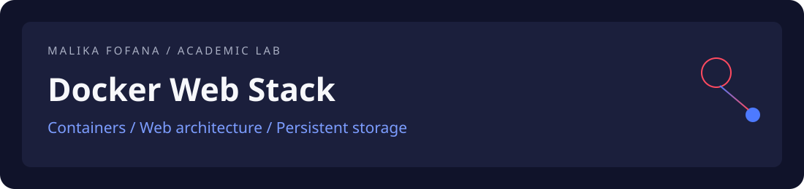

# Docker Web Stack

**Nginx · PHP-FPM · MariaDB · Docker Compose**

Travail pratique de conteneurisation d’une application web : séparer le serveur HTTP, l’exécution PHP et la base de données, puis passer d’un lancement manuel à une orchestration déclarative.

[Architecture](#architecture) · [Démarrage](#démarrage) · [Vérifications](#vérifications) · [Périmètre](#périmètre)

## Architecture

| Service | Rôle | Communication |
| --- | --- | --- |
| `http` | Nginx, point d’entrée HTTP | Port local 8080 ; transfert des scripts vers PHP-FPM |
| `script` | Exécution PHP avec l’extension mysqli | Connexion au service MariaDB `data` |
| `data` | MariaDB | Initialisation SQL ; volume persistant `db_data` à l’étape 3 |

Le projet illustre la séparation des responsabilités, le réseau entre conteneurs, la construction d’images et la persistance des données.

## Parcours technique

| Dossier | Contenu |
| --- | --- |
| [etape0](etape0) | Script de lancement introductif |
| [etape1](etape1) | Nginx + PHP-FPM ; page `phpinfo()` |
| [etape2](etape2) | MariaDB, initialisation SQL et page de lecture/écriture |
| [etape3](etape3) | Docker Compose, images applicatives et volume de données |

## Démarrage

Prérequis : Docker et le plugin Docker Compose. Le port 8080 doit être libre ; les noms de conteneurs `http`, `script` et `data` ne doivent pas être déjà utilisés.

Depuis la racine du dépôt :

```bash
cd etape3
docker compose up -d --build
docker compose ps
```

Ouvrir [la page PHP](http://localhost:8080) puis [le compteur](http://localhost:8080/test.php).

## Vérifications

- La page d’accueil expose `phpinfo()`.
- Chaque visite de `test.php` insère une valeur de compteur et affiche son maximum.
- Les fichiers de [db-init](etape3/db-init) servent à initialiser MariaDB lors de la création de sa base.
- Le volume nommé conserve les données après l’arrêt des services.

```bash
docker compose logs --tail=50
docker compose down
docker compose up -d
```

Ces commandes constituent une procédure de vérification locale ; elles ne sont pas un compte rendu d’exécution automatisée.

## Périmètre

Exercice pédagogique local. La page PHP réalise une insertion et une lecture ; elle ne fournit pas une interface CRUD complète. Les identifiants de démonstration, les images non figées et l’exposition de `phpinfo()` nécessitent une adaptation avant un déploiement. Le compteur `MAX + 1` n’est pas conçu pour des écritures concurrentes.

Les scripts des étapes 1 et 2 utilisent le répertoire courant pour leurs montages : les lancer depuis leur dossier respectif.

---

[Profil de Malika Fofana](https://github.com/malikafofana) · [Telco Signal](https://github.com/malikafofana/telco-signal) · [Evidence Search](https://github.com/malikafofana/evidence-search) · [Alzheimer MRI Study](https://github.com/malikafofana/alzheimer-mri-study)
